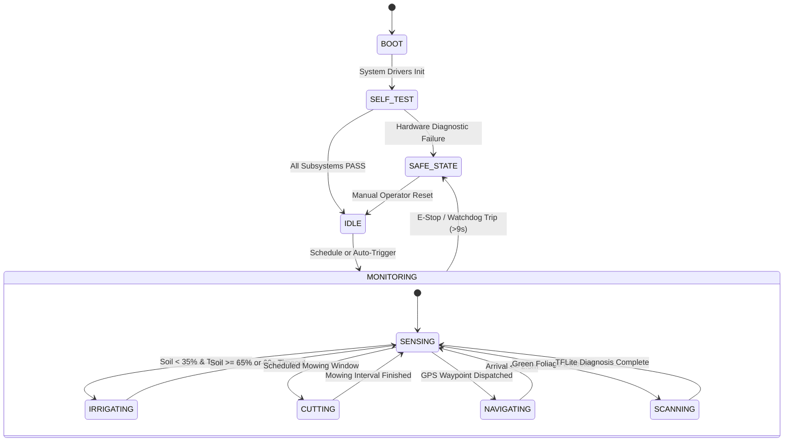

<div align="center">

# 🌱🤖 AgroNex-Pi: Autonomous Smart Agricultural Robot & Edge-AI Farming System
### *An Edge-Computing, Multi-Subsystem Autonomous Rover for Precision Irrigation, Autonomous Crop Scouting, Plant Pathology Diagnosis, and Serverless Cloud Telemetry*

[](https://www.python.org/)
[](https://www.raspberrypi.com/)
[-orange.svg?logo=tensorflow&logoColor=white)](https://www.tensorflow.org/lite)
[-232F3E.svg?logo=amazon-aws&logoColor=white)](https://aws.amazon.com/)
[](https://opensource.org/licenses/MIT)

</div>

---

## 📌 Executive Summary

Modern agriculture faces severe challenges: plant diseases destroy between **10% to 40% of global crop yields**, flood irrigation wastes critical water reserves, and smallholder farmers lack the capital to employ agronomy experts.

**AgroNex-Pi** is a low-cost, fully autonomous agricultural rover engineered on a **Raspberry Pi 4 Model B master** and an **Arduino Uno R3 slave**. It integrates five mission-critical farming subsystems into a single field-ready chassis:
1. **Precision Closed-Loop Irrigation**: Capacitive soil-moisture hysteresis control (35%–65% band) with reservoir level protections.
2. **Grass & Weed Trimming**: Scheduled 12 V high-torque mower blade with safety interlocks.
3. **Autonomous Waypoint Navigation**: NEO-7M GPS receiver + HMC5883L digital compass for outdoor waypoint navigation.
4. **On-Device Plant Pathology Diagnosis**: Quantized MobileNetV2 TensorFlow Lite model running at **~180 ms/frame** on the Pi CPU with zero reliance on cloud connectivity.
5. **Serverless Cloud Telemetry & Farm Dashboard**: AWS API Gateway, Lambda, and S3 pipeline pushing live telemetry every 5 s, with the **Kisan Mitra AI** multilingual agricultural assistant.

---

## 🏗️ System Architecture & Block Diagram

The system employs a **distributed master-slave architecture** to isolate high-frequency sensor polling and motor PWM electrical noise from the Linux operating system and neural network runtime:

```
                                  AGRONEX-PI ARCHITECTURE
                                  
 ┌─────────────────────────────────────────────────────────────────────────────────┐
 │                                  POWER RAILS                                    │
 │  12V Li-ion Battery  ──►  BTS7960 Motor Drivers & 12V Cutter Blade               │
 │                      └──►  LM2596 Buck Converter (Regulated 5V Rail)            │
 │                            ├──► Raspberry Pi 4B (Master)                        │
 │                            └──► 5V Submersible Pump & Relays                    │
 └──────────────────────────────────────┬──────────────────────────────────────────┘
                                        │
           ┌────────────────────────────┴─────────────────────────────┐
           ▼                                                          ▼
┌──────────────────────────────────────┐          ┌──────────────────────────────────────┐
│     RASPBERRY PI 4B (MASTER)        │          │       ARDUINO UNO R3 (SLAVE)         │
│ • Finite State Machine (FSM)         │          │ • PWM Motor Driver Interface         │
│ • Edge AI Inference (MobileNetV2)    │  Serial  │ • 2× BTS7960 43A H-Bridges (4WD)     │
│ • Local Flask Web Server (Port 5000) │◄────────►│ • HC-SR04 Ultrasonic Sonar Radar     │
│ • AWS Cloud Relay Client             │ 115200   │ • Soil Probe Deployment Servo Arm    │
│ • CSI Camera Module (OV5647 5MP)     │   Baud   │ • Emergency Hardware Cutoff Logic    │
│ • ADS1115 16-Bit I²C ADC             │          └──────────────────────────────────────┘
│ • DHT11/22 Environment Sensor        │
│ • NEO-7M GPS + HMC5883L Compass      │
└──────────────────┬───────────────────┘
                   │
                   ▼ HTTPS (REST / JSON) Every 5s
┌─────────────────────────────────────────────────────────────────────────────────┐
│                           AWS SERVERLESS CLOUD STACK                            │
│  AWS API Gateway  ──►  AWS Lambda (Python 3.11)  ──►  Amazon S3 (state.json)    │
│                                                   └──►  Amazon DynamoDB (Users)  │
│                                                   └──►  Live Web Farm Dashboard  │
└─────────────────────────────────────────────────────────────────────────────────┘
```

---

## ⚡ Hardware Bill of Materials (BOM) & Pin Configuration

| Component | Interface / Protocol | Pin Assignment (BCM) | Function / Notes |
|:---|:---|:---|:---|
| **Raspberry Pi 4B (4GB)** | System Master | — | Runs Linux OS, FSM, TFLite inference, Flask server |
| **Arduino Uno R3** | USB Serial | `/dev/ttyACM0` (115200) | Motor PWM, ultrasonic pinging, probe servo |
| **ADS1115 16-bit ADC** | I²C Bus 1 | GPIO 2 (SDA), GPIO 3 (SCL) | Analog sampling: A0 = Soil, A1 = Water Reservoir |
| **Capacitive Soil Sensor v1.2**| Analog | ADS1115 Pin A0 | Corrosion-resistant soil moisture sensing |
| **Water Level Probe** | Analog | ADS1115 Pin A1 | Reservoir level monitoring (lockout at < 15%) |
| **DHT11 / DHT22** | 1-Wire Digital | GPIO 4 | Ambient temperature and humidity tracking |
| **OV5647 5MP Camera** | CSI Ribbon | Camera Interface | Leaf pathology imaging (`picamera2` / OpenCV) |
| **2-Channel 5V Relay** | GPIO Digital Output | GPIO 17 (CH1), GPIO 27 (CH2)| Active-LOW: CH1 = Water Pump, CH2 = Grass Cutter |
| **Dual BTS7960 43A Drivers** | PWM via Arduino/Pi | Pins 5, 6, 13, 19 | High-power skid-steer differential drive for 4 motors |
| **NEO-7M GPS Module** | UART Serial | GPIO 15 (RXD), GPIO 14 (TXD) | NMEA satellite location fixes at 9600 baud |
| **HMC5883L 3-Axis Magnetometer**| I²C Bus 1 | GPIO 2 (SDA), GPIO 3 (SCL) | Magnetic heading for waypoint steering |
| **Active Buzzer & LED** | GPIO Digital Output | GPIO 22 (Buzzer), GPIO 23 (LED)| Auditory/visual feedback and disease alerts |
| **LM2596 Buck Converter** | DC Voltage Step-Down | 12V In $\rightarrow$ 5.1V Out | Clean power rail for Raspberry Pi and 5V pump |

---

## 🧠 Machine Learning: Datasets, Architecture & Gating

### 1. Three Complementary Datasets
To resolve the **domain shift problem** (where models trained on clean laboratory photos drop from 98% down to 40% in real fields), AgroNex-Pi utilizes three distinct datasets:

```
┌─────────────────────────────────┐   ┌─────────────────────────────────┐   ┌─────────────────────────────────┐
│ 1. PlantVillage Benchmark       │   │ 2. Custom Tulsi Dataset         │   │ 3. Custom Local Field Dataset   │
├─────────────────────────────────┤   ├─────────────────────────────────┤   ├─────────────────────────────────┤
│ • ~54,000 lab photos            │   │ • Dedicated botanical set       │   │ • Captured via rover's OV5647   │
│ • Tomato, Potato, Bell Pepper   │   │ • Healthy, Infected, Infested,  │   │ • Healthy, Unhealthy, Yellow,   │
│ • Capped at 180 imgs/class      │   │   Wilting, Background           │   │   Dried, Background             │
│ • Baseline pathology structure  │   │ • Medicinal/campus focus        │   │ • Real soil, shadows, sunlight  │
└─────────────────────────────────┘   └─────────────────────────────────┘   └─────────────────────────────────┘
```

### 2. Two-Stage Transfer Learning Pipeline
* **Backbone**: MobileNetV2 pre-trained on ImageNet.
* **Custom Classification Head**:
  $$\text{Input}(224 \times 224 \times 3) \rightarrow \text{MobileNetV2 Backbone} \rightarrow \text{GlobalAveragePooling2D} \rightarrow \text{Dropout}(0.3) \rightarrow \text{Dense}(N, \text{Softmax})$$
* **Stage 1 (Head Warmup)**: Backbone frozen (`trainable = False`), Adam optimizer ($\text{LR} = 10^{-3}$), 4–8 epochs with Early Stopping.
* **Stage 2 (Deep Fine-Tuning)**: Unfreezes the top 30 convolutional layers while keeping all `BatchNormalization` layers frozen to preserve ImageNet statistics. Trained at an ultra-low learning rate ($\text{LR} = 10^{-5}$) to prevent catastrophic forgetting.
* **Post-Training Quantization**: Converted to dynamic-range quantized TensorFlow Lite format, compressing the model from **14.2 MB to 2.47 MB** with execution times of **~180 ms** on the Raspberry Pi 4 CPU.

### 3. False-Alarm Suppression Pipeline (The 5 Gates)
To prevent erroneous pesticide spraying or false alerts, captured frames pass through **5 sequential software gates**:
1. **Gate 1: Laplacian Blur & Luminance Filter**: Rejects frames with Laplacian variance $\sigma^2 < 12.0$ or extreme luminance ($< 15$ or $> 250$).
2. **Gate 2: Green Foliage Coverage Gate**: Uses an HSV color mask ($H \in [25, 95]$). If green vegetation occupies $< 8\%$ of the frame, the scan aborts (no leaf present).
3. **Gate 3: Morphological Leaf Segmentation**: Isolates individual leaf contours from background mulch and soil.
4. **Gate 4: 3×3 Spatial Patch Majority Voting**: Divides the leaf into a 3×3 grid; requires $\ge 5$ of 9 patches to agree on the pathological condition.
5. **Gate 5: Softmax Confidence Threshold**: The top prediction probability must be $\ge 70\%$.

---

## 📈 Experimental Results & Performance Benchmarks

Evaluated on a held-out test split of **666 images across 18 target classes**:

| Metric | Benchmark Result | Practical Operational Impact |
|:---|:---:|:---|
| **Overall Weighted F1-Score** | **93.6%** | High balance between precision and sensitivity across all disease types |
| **Macro Average F1-Score** | **92.7%** | Strong diagnostic capability across both common and rare conditions |
| **Overall Precision** | **93.8%** | Only ~6% chance of a false disease alert |
| **Overall Recall (Sensitivity)** | **93.5%** | Successfully catches 94 out of 100 actual plant diseases |
| **Pi Camera Field Model F1** | **92.4%** | Successfully eliminates the outdoor domain shift |
| **Background Rejection F1** | **98.0%** | Zero false triggers on garden soil, plastic pots, or hands |
| **Inference Latency** | **180 ms / frame** | Rapid real-time classification on the Raspberry Pi 4 CPU |
| **Irrigation Target Hysteresis**| **35% – 65%** | Maintains optimal root zone moisture without over-watering |
| **GPS Waypoint Arrival Error** | **2.3 m** | Consistent with NEO-7M satellite positioning limits |

---

## 🔄 Software Finite State Machine (FSM)

The central controller (`main.py`) runs an event-driven Finite State Machine to enforce physical safety interlocks:



* **Relay Safety Guarantee**: Relay GPIO pins are initialized to `GPIO.HIGH` *before* enabling output direction, completely eliminating boot relay chatter.
* **Electrical Interlock**: The high-current cutter blade and water pump are barred from running concurrently with the 4WD drive motors, protecting the 12 V battery rail from voltage sags.

---

## ☁️ AWS Cloud Stack & Kisan Mitra AI

AgroNex-Pi features a **100% serverless cloud telemetry pipeline**:
* **AWS API Gateway**: Exposes HTTPS endpoints with CORS support (`/telemetry`, `/state`, `/command`, `/scan`, `/scans`, `/scan_request`).
* **AWS Lambda (`lambda_function.py`)**: Stateless Python 3.11 execution handling payload validation, S3 synchronization, and RSS blog aggregation.
* **Amazon S3**:
  * `state.json`: Real-time telemetry snapshot (updated every 5 s).
  * `pending_command.json`: Atomic cloud-to-rover command queue.
  * `scans/`: Leaf scan photos and diagnostic history.
* **Amazon DynamoDB**: User credential storage and role-based access management.
* **🌾 Kisan Mitra AI**: Integrated AI farming assistant powered by the Mistral AI API, delivering multilingual agronomic advice and organic treatment guidance directly on the dashboard.

---

## 💻 Repository Directory Structure

```text
AgroNex-Pi/
├── README.md                                  # Complete A-to-Z project manual
├── .gitignore                                 # Git ignore rules for archives & logs
├── requirements-pi.txt                        # Python dependencies for Raspberry Pi
├── config.py                                  # Unified configuration & pin definitions
├── main.py                                    # Master multi-threaded FSM supervisor
├── hardware.py                                # Hardware Abstraction Layer (HAL)
├── database.py                                # Local SQLite persistence manager
├── disease_detect.py                          # 5-Gate TFLite edge inference engine
├── disease_db.py                              # Agronomic knowledge base & treatments
├── irrigation.py                              # Hysteresis irrigation controller
├── cutter.py                                  # Scheduled grass cutting controller
├── navigation.py                              # GPS & Compass waypoint navigator
├── aws_relay.py                               # AWS API Gateway telemetry syncer
├── app.py                                     # Local Flask dashboard web application
├── capture_field_dataset.py                   # Live Camera Dataset Studio (port 8080)
├── train_plant_disease_model.py               # Two-stage transfer learning trainer
├── train_custom_plant_model.py                # Dedicated local plant / Tulsi trainer
│
├── arduino/
│   └── AgroNex_Arduino_Slave/
│       └── AgroNex_Arduino_Slave.ino          # Arduino Uno slave firmware (PWM, sonar)
│
├── aws/
│   ├── lambda_function.py                     # AWS Lambda serverless backend handler
│   └── agronex_dashboard/
│       ├── index.html                         # Cloud-hosted farm dashboard interface
│       └── setup_autostart.sh                 # Systemd auto-start configuration script
│
├── models/
│   ├── plant_model.tflite                     # Production quantized MobileNetV2 (2.47 MB)
│   ├── labels.txt                             # Production class labels
│   ├── custom_plant_model.tflite              # Dedicated Tulsi/Local model
│   └── custom_labels.txt                      # Custom class labels
│
├── diagrams/
│   ├── system_block_diagram.svg               # Vector architecture block diagram
│   ├── system_block_diagram.jpg               # High-res architecture image
│   ├── project_flowchart.svg                  # Vector operational flowchart
│   └── project_flowchart.jpg                  # High-res flowchart image
│
├── static/ & templates/                       # Local web dashboard UI assets & CSS
│
├── test_*.py                                  # Hardware diagnostic & validation scripts
│   ├── test_soil.py                           # ADS1115 soil moisture calibration test
│   ├── test_water.py                          # Water reservoir sensor test
│   ├── test_relay.py                          # Active-LOW relay interlock verification
│   ├── test_motors.py                         # BTS7960 motor driver PWM test
│   ├── test_dht.py                            # DHT11/22 1-wire environment test
│   ├── test_camera.py                         # CSI camera capture & focus test
│   ├── test_disease_camera.py                 # End-to-end live camera AI demo
│   └── test_all_sensors.py                    # Complete multi-sensor self-test suite
│
└── field_dataset/                             # Local field dataset samples & README
```

---

## 🚀 Quick Start Guide: Installation & Deployment

### 1. Enable Hardware Interfaces on Raspberry Pi
Open `raspi-config` on Raspberry Pi OS Bullseye (64-bit):
```bash
sudo raspi-config nonint do_i2c 0
sudo raspi-config nonint do_spi 0
sudo raspi-config nonint do_serial 2
```

### 2. Install Dependencies
```bash
# Clone the repository
git clone https://github.com/nikhilgurav46/AgroNex-Pi.git
cd AgroNex-Pi

# Create Python virtual environment with system access for picamera2
python3 -m venv --system-site-packages agronex_env
source agronex_env/bin/activate

# Install Python packages
pip install -r requirements-pi.txt
```

### 3. Flash Arduino Slave Firmware
Open `arduino/AgroNex_Arduino_Slave/AgroNex_Arduino_Slave.ino` in the Arduino IDE and flash it to the connected Arduino Uno via USB (`/dev/ttyACM0` at 115200 baud).

### 4. Run Hardware Diagnostic Verification
Verify all physical subsystems before operating the robot:
```bash
python3 test_all_sensors.py     # Verifies ADS1115, DHT, GPS, Compass
python3 test_relay.py           # Verifies pump & cutter active-LOW relays
python3 test_motors.py          # Verifies 4WD BTS7960 motor drivers
python3 test_disease_camera.py  # Demonstrates real-time on-device leaf AI
```

### 5. Launch AgroNex-Pi Autonomous Controller
```bash
# Start full supervisor on local web port 5000:
python3 main.py

# Alternatively, simulate on a laptop without physical hardware:
python3 main.py --simulate --port 5000
```
Open `http://<raspberry-pi-ip>:5000` in any web browser to view the live cockpit dashboard!

---

## 🌍 Sustainable Development Goals (SDG) Alignment

* **SDG 2: Zero Hunger** (Target 2.4) — Enables early detection of devastating crop pathogens before they spread, protecting seasonal harvest yields.
* **SDG 6: Clean Water and Sanitation** (Target 6.4) — Uses precise closed-loop capacitive sensing to eliminate over-irrigation, saving up to 40% water compared to conventional timer systems.
* **SDG 9: Industry, Innovation, and Infrastructure** — Demonstrates edge-computed Artificial Intelligence on low-cost hardware accessible to small-scale farmers.
* **SDG 12: Responsible Consumption and Production** (Target 12.4) — Enables targeted micro-application of fungicides, drastically reducing chemical runoff into soil and groundwater.

---

## 👥 Contributors & Acknowledgements

* **Author**: Nikhil Gurav ([@nikhilgurav46](https://github.com/nikhilgurav46))
* **Institution**: B.Tech Major Project Submission
* **Special Thanks**: Guide, Department Faculty, and the open-source communities behind Raspberry Pi, TensorFlow Lite, and PlantVillage.

---

<div align="center">
<b>AgroNex-Pi &copy; 2026 | Built with passion for smarter, sustainable agriculture 🌱</b>
</div>
